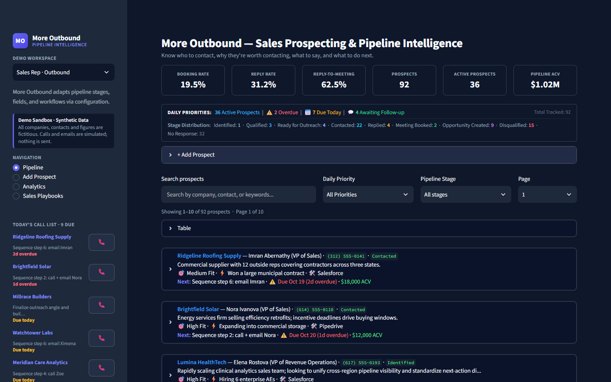
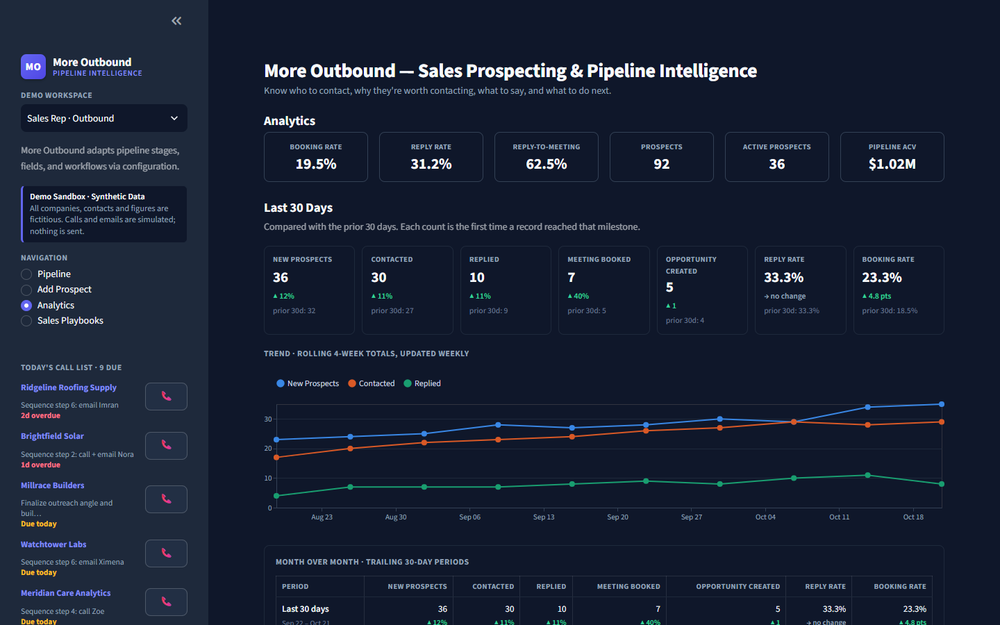
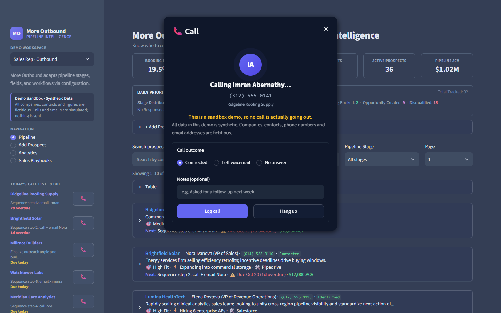
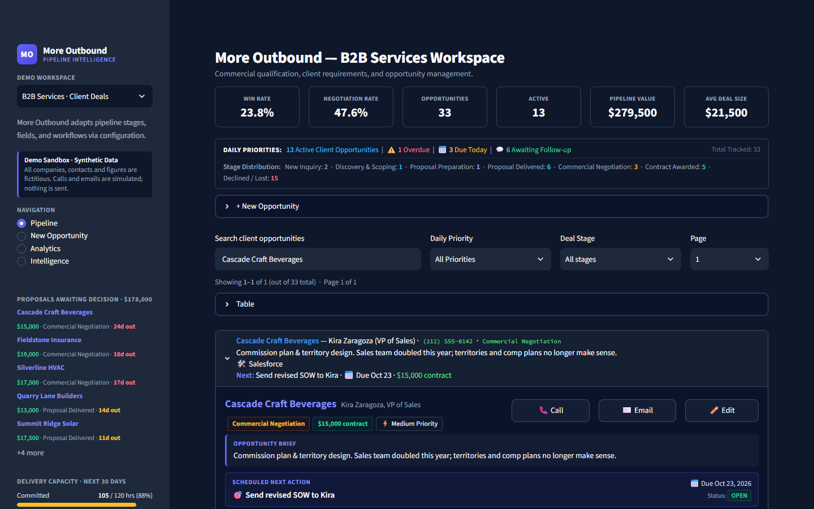

# More Outbound

Pipeline intelligence for people who sell on their own: one sales rep working an outbound
book, or one consultant running client deals. Built with Python and Streamlit.

**▶ Live demo: [moreoutbound.com](https://moreoutbound.com)** · All demo data is synthetic; companies, contacts,
phone numbers and emails are fictitious, and nothing is ever sent.



## What it does

- **Two workspaces, one codebase.** A Sales Rep outbound pipeline and a B2B Services consultant
  pipeline. Stages, fields, KPIs, labels and sidebar tools all come from JSON config
  (`config/demo_sales_rep.json`, `config/demo_b2b_services.json`).
- **A pipeline you can work.** Daily priorities (overdue, due today, awaiting follow-up), prospect
  cards with account intelligence and suggested outreach angles, a next-action lifecycle (complete,
  reschedule, replace), stage changes and an activity timeline.
- **Analytics that answer "is it working?"** Headline KPIs, last 30 days vs the prior 30, a rolling
  4-week trend, a month-over-month table, current pipeline by stage, the largest open deals and a
  historical conversion funnel.
- **Sidebar tools per workspace.** Sales Rep: today's call list and weekly activity goals.
  Consultant: proposals awaiting decision and committed vs available delivery capacity. Click any
  company to jump straight to its card.
- **Sandbox contact actions.** Call and Email open realistic dialogs and log the activity to the
  timeline and weekly goals, without placing a call or sending a message.
- **Data that never goes stale.** 13 weeks of history for one rep (92 prospects) and one consultant
  (33 deals), generated by a deterministic simulation (`tools/build_demo_fixtures.py`) and stored as
  relative dates, so the demo always reads as "today".

| Analytics | Sandbox call | Consultant workspace |
|---|---|---|
|  |  |  |

**Stack:** Python 3.12 · Streamlit · Pydantic · Altair · ports-and-adapters architecture ·
300+ offline tests (`tools/run_tests.py`).

## Run the demo locally

Python 3.12 is the tested runtime. From the repository root:

```powershell
python -m venv .venv
.venv/Scripts/python.exe -m pip install -r requirements-demo.txt
.venv/Scripts/python.exe -m pipeline.launch --mode demo
```

Open http://localhost:8501 and switch workspaces from the sidebar. To launch straight into one
workspace, set `PIPELINE_INSTANCE_CONFIG`, e.g. `$env:PIPELINE_INSTANCE_CONFIG='config/demo_b2b_services.json'`.
A missing or invalid configuration shows a safe error message.

To regenerate the synthetic data after changing the simulation: `python tools/build_demo_fixtures.py`
(`--check` prints the month-over-month stats without writing).

## Configuration and metrics

`config/demo_sales_rep.json` and `config/demo_b2b_services.json` define versioned identity/branding, ordered stages, active/terminal states, milestone IDs, typed fields, navigation, feature flags, action labels, integration capabilities, storage, dashboard modules, metrics, sidebar widgets, weekly activity targets and delivery capacity.

Fields support text, long text, currency, number and ISO dates, required validation, visibility/editability, intake/card/table placement and finite formatters; the supported keys are listed in `FIELD_TYPES` (`pipeline/domain/instance_config.py`). Public demo storage is in-memory; integrations and external provider features are disabled. Unknown fields/metrics, duplicate IDs and incompatible features fail validation. JSON never executes formulas.

| Metric | Definition | Seed result |
|---|---|---|
| Booking Rate | Contacted records that ever booked / contacted records | Sales Rep: 15 / 77 = 19.5% |
| Reply Rate | Contacted records that ever replied / contacted records | Sales Rep: 24 / 77 = 31.2% |
| Reply-to-Meeting | Replying records that ever booked / replying records | Sales Rep: 15 / 24 = 62.5% |
| Win Rate | Proposals delivered that were awarded / proposals delivered | B2B: 5 / 21 = 23.8% |
| Negotiation Rate | Proposals delivered that reached negotiation / proposals delivered | B2B: 10 / 21 = 47.6% |
| Pipeline ACV / Value | Value of records currently in active, nonterminal stages | $1,022,500 / $279,500 |
| Avg Deal Size | Pipeline value / active records with a value | B2B: $21,500 |

Each stable ID counts once. Recorded stage/activity achievements survive later stage changes, disqualification and meeting cancellation. Cancellation alone does not imply a booking. Missing/malformed history is ignored, and intermediate stages are never inferred. Zero denominators display an em dash. The funnel counts records achieving every preceding milestone: 92 → 77 → 24 → 15 → 9 for the Sales Rep workspace. Month-over-month figures compare trailing 30-day periods and count the first time each record reached a milestone. Pipeline metrics describe the entire session, independently of the list filters.

## Architecture

Canonical code lives in `pipeline/`: domain models/services, ports, primary UI/CLI drivers and secondary adapters. The demo UI is `pipeline/adapters/primary/public_ui.py` (pages) and `demo_widgets.py` (sidebar tools and sandbox dialogs); metrics and trends live in `pipeline/domain/outreach_metrics.py`. Account intelligence is read from `intel.json.example`.

Run automated checks through the isolated runner:

```powershell
.venv/Scripts/python.exe tools/run_tests.py
```

The runner uses disposable source copies, synthetic fixtures, no dotenv loading, stripped provider environment and blocked external sockets. Loopback is allowed for Streamlit tests. Runtime dependencies are Streamlit and Pydantic. Pytest is unnecessary. Launch from a source checkout.

## Hosting and limitations

See [Demo deployment](docs/demo-deployment.md). Procfile and Railway explicitly launch demo mode; `nixpacks.toml` installs `requirements-demo.txt` and `.python-version` pins Python 3.12. Edits are session-local, disappear when that session expires or the server restarts, and restore the seed data upon page refresh. Do not enter sensitive data into a public demonstration.

## License

Copyright © 2026 Matthew Hackett. All rights reserved; see [LICENSE](LICENSE). The code is published for viewing as a portfolio project.

